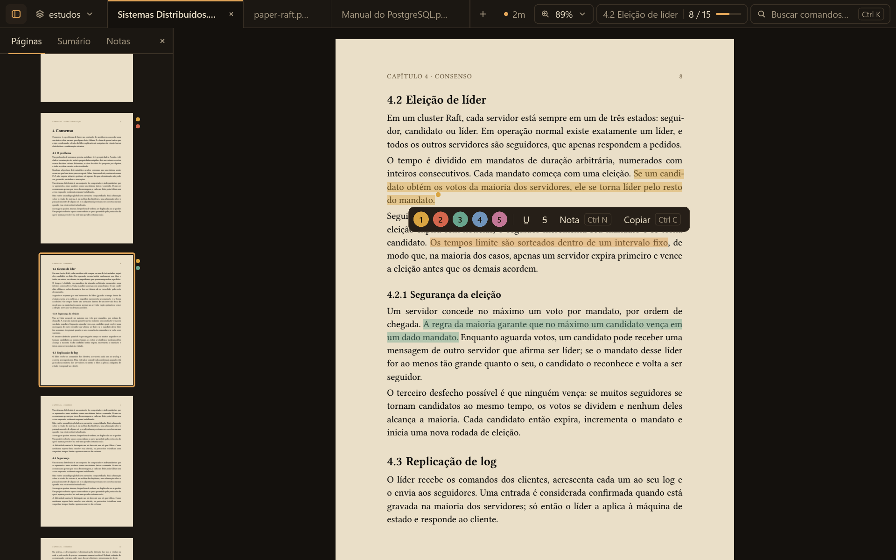
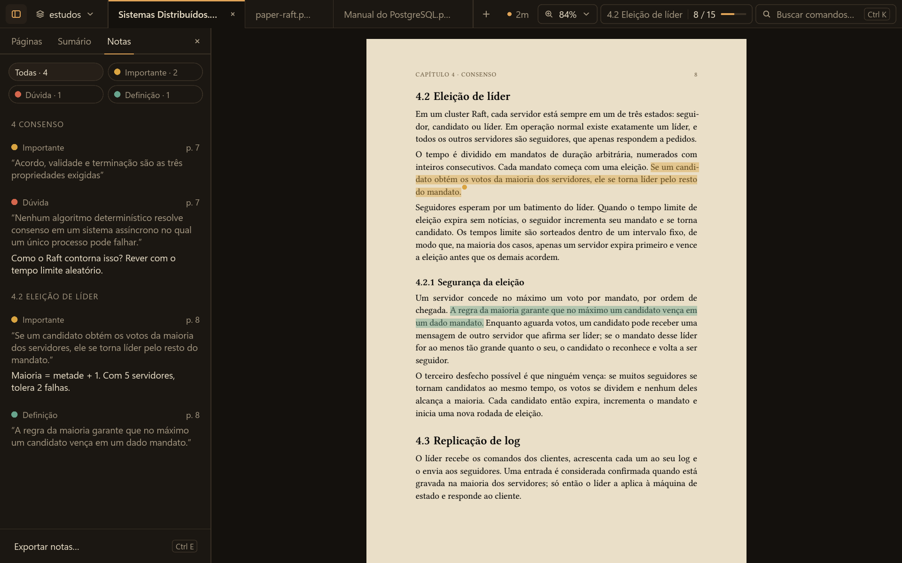
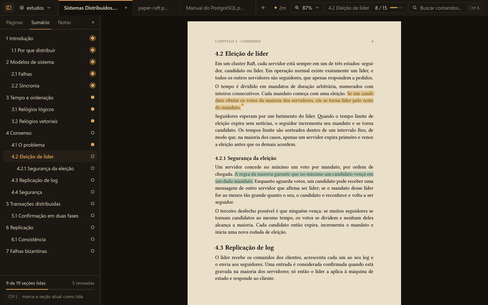
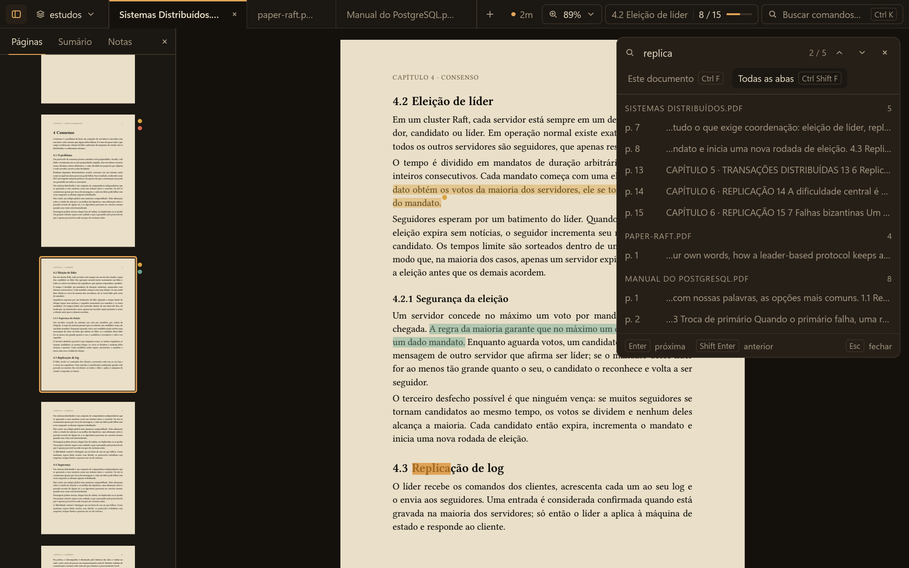
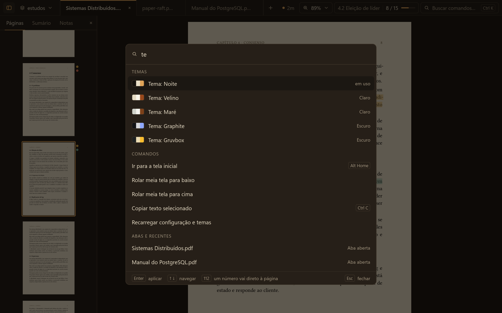
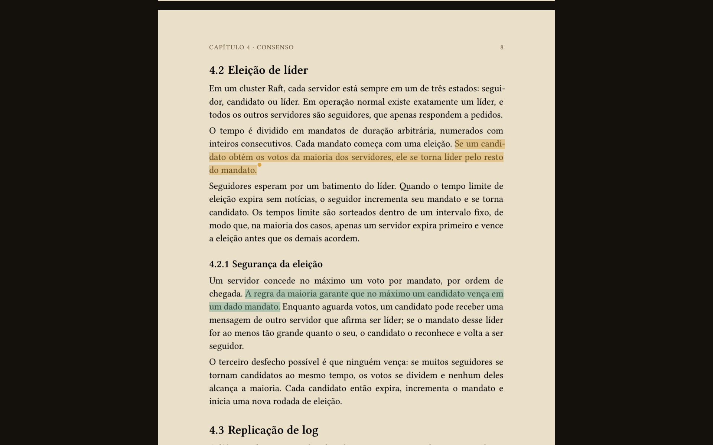
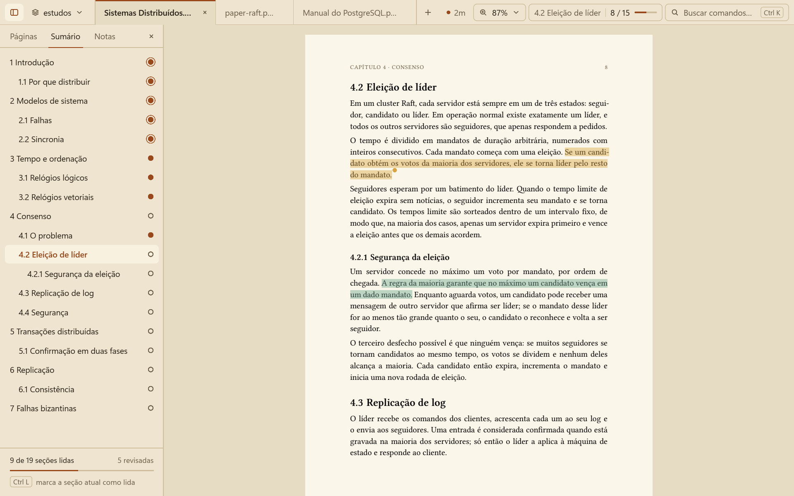

# Leme

A fast, minimal, local-first PDF reader for Windows, built with Rust and Slint.

Leme is a calm, keyboard-first reading environment: the page fills the screen, and controls stay hidden until you need them. It is built to be customized: themes and keybindings are plain TOML files. There is no telemetry and no accounts; the only network request is an update check against GitHub releases, which asks before installing anything and can be turned off.

**[Website](https://diegorezm.github.io/leme/) · [Download](https://github.com/diegorezm/leme/releases/latest) · [Docs](DOCS.md)**

## Features

- **Interface:** one quiet header holds the session, tabs, study time, where you are (section, page, and how far through), and a zoom menu; a search box opens the command palette. Search is a small panel at the top right, and the palette, note editor, and export sheet dim the document behind them. Dark Noite by default, light Velino as a peer, every shortcut shown next to its control.
- **Reading:** continuous scrolling, fit width / fit page / custom zoom (also `Ctrl`+wheel), go to page (numbers or page labels like `iv`), clickable links, fullscreen, and a **focus mode** that hides everything but the page.
- **Sidebar:** page thumbnails, the document's outline, or a list of your notes; click to jump.
- **Tabs and sessions:** open several PDFs at once. Group them into named sessions, like tmux: one for your thesis, one for a course. Switch with `Ctrl+Shift+S`; Leme reattaches to the last session on startup, each tab at the page and zoom you left it.
- **Annotations:** select text (across pages, too) to highlight it (5 numbered pigments), underline, strike through, attach a note, or copy it. Double-click selects a line; hovering a note shows it. **Export your notes to Obsidian-ready Markdown:** properties, one callout per quote linking to its page (`[[book.pdf#page=12|p. 12, line 7]]`), and stable `^leme-<id>` block ids you can link to from other notes. Notes are stored next to your settings; the PDF is never modified.
- **Studying:** highlight colors with a meaning (*Important*, *Doubt*, *Definition*, *Example*, *Review*, renamed as you like) on keys `1`–`5`, a notes panel filtered by color, an export sheet with a preview of the file, sections marked read and reviewed with progress per document, a study timer, and exports to a Markdown summary, **Anki cards**, or CSV.
- **Search:** in-document text search with match highlighting (`Enter` / `Shift+Enter` to step), *All tabs* to search the whole session ignoring accents, with the pages found grouped by document, and `art. 37` to jump to an article of a law.
- **Command palette** (`Ctrl+K`): every command, open tab, recent file, and theme, with fuzzy matching. Type a number to jump to that page.
- **Customizable:** themes, interface font, density, and keybindings in TOML, optional **vim keys**, and page colors for night reading: *paper* tints the PDF's white with the theme's page color, *inverted* turns it dark.
- **Interface in Brazilian Portuguese** (default) or English.
- Opens password-protected PDFs; drop files on the window to open them.

## Screenshots

| | |
|---|---|
|  |  |
| Highlights and notes | Outline, thumbnails, or notes in the sidebar |
|  |  |
| Search with highlighted matches | Command palette |
|  |  |
| Focus mode | Light Paper theme, one of thirteen built in |

## Install

Download the installer or the portable `.zip` from [Releases](https://github.com/diegorezm/leme/releases/latest). Setup, shortcuts, customization, and building from source are in [DOCS.md](DOCS.md).

## Contributing

Read [AGENTS.md](AGENTS.md) for the product philosophy, architecture, and workflow, and [DOCS.md](DOCS.md#building-from-source) to build and test.

## License

[MIT](LICENSE)
